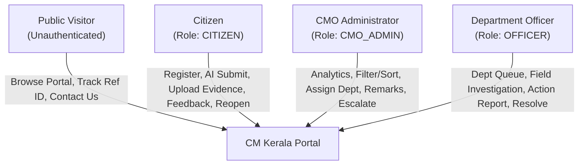

# 01 — Project Overview: CM Kerala Public Grievance Redressal Portal

> **Recruitment Prototype Disclaimer:** This system is a demonstration prototype developed for **WhiteMatrix Software Solutions**. It is **not** an official Government of Kerala portal and is not affiliated with or endorsed by the Office of the Chief Minister of Kerala.

---

## 1. Problem Statement

Citizens across Kerala's 14 districts frequently encounter civic and administrative issues—ranging from damaged roads, drinking water disruption, and power outages to delayed pension verification and hospital staffing gaps. Traditional grievance channels often suffer from:

- **Fragmented Intake:** Citizens struggle to identify which state department owns a specific civic problem.
- **Opaque Processing:** Petitioners lack a single, real-time tracking reference to verify who is reviewing or acting on their complaint.
- **Manual Triage Bottlenecks:** Administrative staff at the Chief Minister's Office (CMO) spend substantial manual effort reading unstructured complaints, identifying urgency, detecting repeated submissions, and routing files to line departments.
- **Limited Accountability & Closure Verification:** Without structured action-taken reports, SLA delay tracking, and citizen feedback loops, unresolved complaints can linger without escalation or formal closure.

The **CM Kerala Public Grievance Redressal Portal** addresses these challenges by uniting a citizen-friendly web portal, AI-assisted triage (`openai/gpt-oss-120b` via Groq), centralized CMO oversight, department officer investigation tools, and a chronological audit trail into one cohesive full-stack application.

---

## 2. Project Objectives

1. **Single-Window Statewide Access:** Provide 24/7 digital grievance filing and tracking across all **14 Kerala districts** and **10 core state departments**.
2. **Instant Traceability:** Automatically generate a unique Reference ID (`GRV-YYYYMMDD-XXXXX`) upon submission and allow anyone to track status updates publicly without requiring login.
3. **Human-in-the-Loop AI Triage:** Assist citizens and CMO reviewers using LLM classification (department suggestion, category, priority level, concise 100-character CMO summary) and duplicate risk detection against recent database submissions—without taking autonomous routing decisions away from humans.
4. **CMO Oversight & Escalation:** Equip CMO administrators with real-time KPI dashboards, overdue monitoring (`>7 days` unresolved), Recharts analytics, official remarking, department assignment, and one-click escalation to `HIGH` priority.
5. **Structured Departmental Execution:** Give department officers a scoped queue to inspect complaints, view CMO instructions, upload field evidence, log Action Taken Reports, and submit final resolution details.
6. **Closed-Loop Citizen Feedback & Reopening:** Empower citizens to rate resolved grievances (`1–5` stars + review comment) or reopen a resolved case with a documented reason if the issue persists.

---

## 3. Scope & Coverage

### Geographic Coverage (All 14 Kerala Districts)
`Thiruvananthapuram`, `Kollam`, `Pathanamthitta`, `Alappuzha`, `Kottayam`, `Idukki`, `Ernakulam`, `Thrissur`, `Palakkad`, `Malappuram`, `Kozhikode`, `Wayanad`, `Kannur`, and `Kasaragod`.

### Participating State Departments (10 Seeded Departments)

| Code | Department Name | Primary Domain |
| :--- | :--- | :--- |
| `PWD` | Public Works Department | State highways, district roads, bridges, culverts, public buildings |
| `HLTH` | Health Services | Government medical colleges, taluk hospitals, PHCs, sanitation |
| `EDU` | Education Department | Government schools, higher secondary infrastructure, midday meals |
| `REV` | Revenue Department | Land records, *pattayam*, village offices, disaster relief, certificates |
| `WTR` | Water Resources | Drinking water pipelines, irrigation canals, borewells, watershed care |
| `KSEB` | Kerala State Electricity Board | Power distribution lines, transformers, streetlights, outage restoration |
| `AGRI` | Agriculture Department | Crop insurance, paddy procurement, farmer subsidies, Krishi Bhavan |
| `TRNS` | Transport Department | KSRTC bus schedules, rural route permits, road safety, motor vehicles |
| `FRST` | Forest Department | Human-wildlife conflict mitigation, solar fencing, forest protection |
| `SWD` | Social Welfare Department | Welfare pensions, senior citizen care, disability & women/child support |

### Grievance Lifecycle States
- `SUBMITTED` — Newly filed by a citizen; awaiting CMO triage.
- `UNDER_REVIEW` — Under examination by CMO or submitted by an officer to the CMO for verification.
- `IN_PROGRESS` — Assigned by CMO to a state department for field investigation and action.
- `RESOLVED` — Remediation completed and resolution details recorded.
- `REOPENED` — Reopened by a dissatisfied citizen (or status reverted) for further investigation.

---

## 4. Key Stakeholders & Roles

| Stakeholder | Role Identifier | Responsibilities & Capabilities |
| :--- | :--- | :--- |
| **Public Visitor** | *(Unauthenticated)* | Views portal information, live public statistics, state department directory, FAQs, submits contact enquiries, and tracks any grievance by Reference ID. |
| **Citizen** | `CITIZEN` | Registers and logs in; drafts grievances with optional AI triage; uploads supporting evidence (`<= 5 MB`); monitors personal dashboard; views timeline, CMO remarks, and officer reports; submits feedback or reopens resolved cases. |
| **CMO Administrator** | `CMO_ADMIN` | Monitors statewide statistics and Recharts analytics; filters by district, category, priority, status, and overdue (`>7 days`) flag; reviews AI triage metadata; assigns cases to departments; posts CMO remarks; updates statuses; escalates delayed grievances. |
| **Department Officer** | `OFFICER` | Bound to a specific `department_id`; views only grievances assigned to their department; inspects citizen complaints, attachments, and CMO remarks; records investigation remarks, Action Taken Reports, Resolution Details, and attachment files; transitions case statuses. |

---

## 5. Comprehensive Feature Breakdown

### 5.1 Public Portal & Transparency
- **Home Page (`/`):** Hero banner with stylized Kerala State Grid visual, live stats bar (`total`, `resolved`, `pending`, `departments_count`) fetched from `GET /api/stats/public`, 5-step process overview, featured departments grid, citizen story highlights, and prototype disclaimer.
- **Informational Pages:** `/about`, `/how-it-works`, `/departments` (with live search by name, code, or description), `/faq` (interactive accordion), and `/contact` (backed by `POST /api/contact` persisting into `contact_enquiries`).
- **Public Grievance Tracker (`/track`):** Accepts a Reference ID (`GRV-YYYYMMDD-XXXXX`), displays status & priority badges, assigned department, CMO remarks, public attachments, and chronological history timeline.

### 5.2 Authentication & Role-Based Access Control (RBAC)
- **Citizen Registration (`/register`):** Validates name, email, mobile, and password; checks duplicate emails (`409 Conflict`); hashes passwords using `bcrypt`; issues a 7-day `HS256` JWT.
- **Unified Login (`/login`):** Authenticates `CITIZEN`, `CMO_ADMIN`, and `OFFICER` accounts, redirecting each to their role-specific dashboard, and provides 1-click demo credential autofill buttons for testing.
- **Strict Enforcement:** Backend FastAPI dependencies (`get_current_user`, `require_role`) and frontend `ProtectedRoute` components isolate Citizen, CMO, and Officer routes and enforce resource-level ownership/department boundaries.

### 5.3 AI Grievance Assistant (Human-in-the-Loop)
- **Live Classification:** Uses Groq `openai/gpt-oss-120b` to recommend the target department (normalized to the 10 seeded Kerala departments), category, priority (`LOW` / `MEDIUM` / `HIGH`), and a `<= 100` character CMO summary.
- **Duplicate Risk Detection:** Compares the draft grievance against the 25 most recent database grievances using both deterministic keyword overlap (`_find_keyword_duplicates`) and LLM semantic comparison over the top 10 recent entries.
- **Human Control & Labelled Fallback:** Citizens review suggestions before clicking *Apply AI Suggestions to Form*; if Groq is unreachable or misconfigured, a deterministic fallback classifier returns labelled fallback output (`is_fallback: true`) while preserving keyword duplicate alerts.

### 5.4 Citizen Workbench
- **Dashboard (`/citizen/dashboard`):** Displays personal summary KPIs (Total Submitted, Pending / Active, Resolved) and tabular list of submitted grievances.
- **Guided Submission (`/citizen/submit`):** Split-pane layout pairing the grievance form with the interactive AI Assistant panel, file upload (`JPG`, `JPEG`, `PNG`, `GIF`, `PDF`, `DOC`, `DOCX`, `TXT` up to `5 MB`), and a post-submit confirmation modal with one-click Reference ID copy.
- **Detail, Feedback & Reopen (`/citizen/grievances/:id`):** Displays full metadata, CMO remarks, officer Action Taken Reports & Resolution Details, additional file upload, star-rating feedback form (`1–5` stars + comment when `RESOLVED`), and a *Reopen Grievance* modal requiring a reason.

### 5.5 CMO Command & Analytics Center
- **KPIs & Charts (`/cmo/dashboard`):** 5 KPI cards (`Total`, `Pending`, `Resolved`, `Overdue (>7d)`, `Escalated`) alongside 3 Recharts visualizations (Status Distribution Pie Chart, Top 10 Districts Bar Chart, Assigned Grievances by Department Bar Chart).
- **Filtering & Triage Table:** Server-side filters (`district`, `category`, `priority`, `status`) + client-side `Overdue Only (>7d)` filter and column sorting (`district`, `priority`, `status`, `created_at`) with visual `ESC` and `OVERDUE` tags.
- **Case Control (`/cmo/grievances/:id`):** Displays citizen contact details (`name`, `email`, `mobile`), AI Triage Assessment card, Department Assignment form (automatically transitions status to `IN_PROGRESS` and creates a `department_assignments` record), CMO Remarks editor, manual Status updater, and Escalation trigger (`is_escalated = true`, `priority = HIGH`).

### 5.6 Department Officer Workbench
- **Department Queue (`/officer/dashboard`):** Displays the officer's assigned department header and filter tabs (`All Assigned`, `In Progress`, `Under Review`, `Reopened`, `Resolved`).
- **Investigation & Resolution (`/officer/grievances/:id`):** Allows officers to inspect complaint text, attachments, and CMO instructions; update status (`IN_PROGRESS`, `UNDER_REVIEW`, `RESOLVED`, `REOPENED`); record chronological investigation remarks; update `action_report` and `resolution_details` on the `department_assignments` record; and attach field inspection reports.
