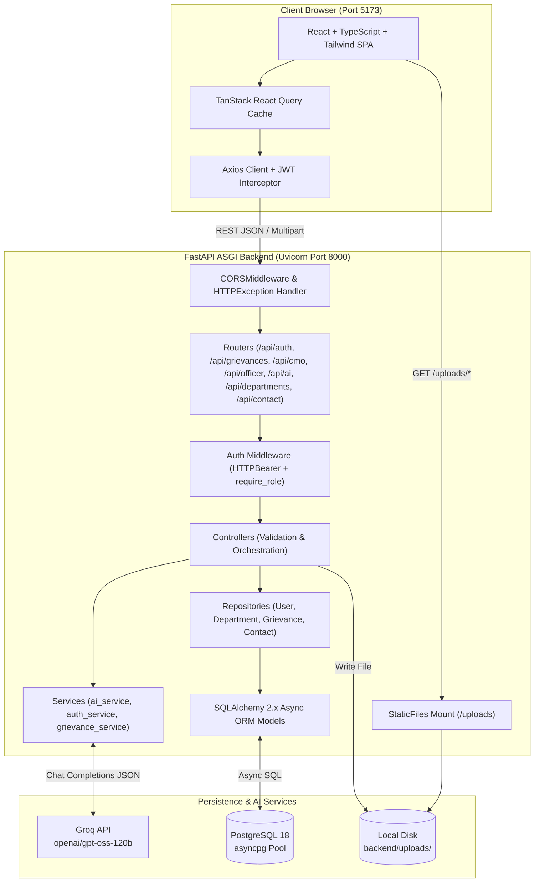
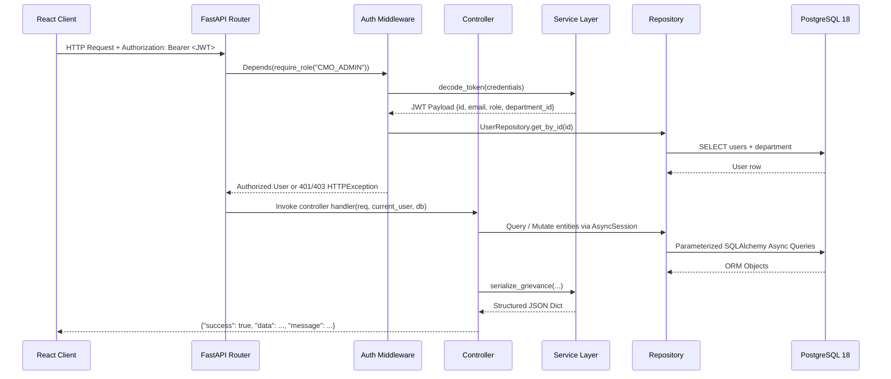
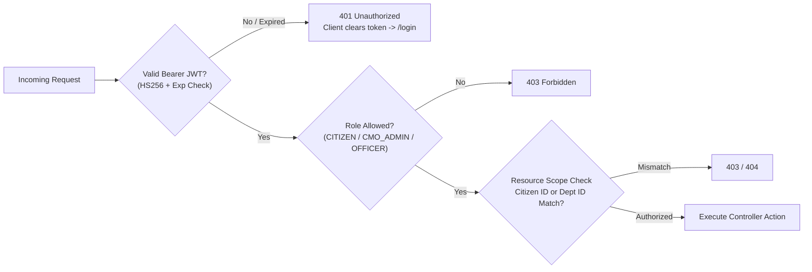

# 02 — System Architecture

## 1. Architecture Overview

The **CM Kerala Public Grievance Redressal Portal** follows a decoupled **client–server layered architecture**:

1. **Presentation Layer (Frontend SPA):** Built with **React** (configured with **Vite**, **TypeScript**, and **Tailwind CSS**), communicating over HTTPS/HTTP REST JSON APIs via **Axios** and **TanStack React Query**.
2. **Application & API Layer (Backend REST Service):** Built with **FastAPI** running on **Uvicorn** (ASGI). Internally organized into strict separation-of-concerns tiers: **Routers → Middlewares → Schemas → Controllers → Services → Repositories → ORM Models**.
3. **Data Persistence Layer:** **PostgreSQL 18** accessed asynchronously through **SQLAlchemy 2.x** (`create_async_engine` + `asyncpg`) with schema versioning managed by **Alembic**, plus local filesystem storage mounted at `/uploads` for uploaded evidence files.
4. **External AI Inference Layer:** **Groq Cloud API** serving the `openai/gpt-oss-120b` model via the `openai` Python `AsyncOpenAI` SDK, supplemented by an in-process keyword duplicate matcher and fallback classifier.



---

## 2. Frontend Architecture (`frontend/`)

### 2.1 Technology Stack
- **Build & Runtime:** Vite (`^8.3.6`), React (`^19.3.1` in `frontend/package.json`, compatible with React 18+ hooks/router patterns), TypeScript (`~7.0.2`), Tailwind CSS (`^3.4.19`).
- **Routing:** `react-router-dom` (`BrowserRouter`, `Routes`, `Route`, `Navigate`) with a custom `<ProtectedRoute role="..." />` wrapper (`frontend/src/App.tsx`).
- **Server State & Forms:** `@tanstack/react-query` (`QueryClientProvider`, `useQuery`, `useMutation`) and `react-hook-form`.
- **Visualization & UI:** `recharts` (`PieChart`, `BarChart`, `ResponsiveContainer`), `lucide-react` icons, and `react-hot-toast` notifications.
- **Visual Theme:** Kerala Government inspired palette configured in `frontend/tailwind.config.js`:
  - `kerala-green`: `#1a5c38` (`light`: `#2d7a52`, `dark`: `#0f3d25`)
  - `kerala-gold`: `#c9a227` (`light`: `#e5c060`)

### 2.2 Frontend Directory Structure
| Path | Responsibility |
| :--- | :--- |
| `src/App.tsx` | Route definitions across Public, Auth, Citizen, CMO, and Officer portals + `<ProtectedRoute>` role guard |
| `src/lib/api.ts` | Shared Axios instance (`VITE_API_URL`), Bearer token request interceptor, and `401` session expiry interceptor |
| `src/lib/auth.ts` | LocalStorage persistence helpers (`getUser`, `getToken`, `setAuth`, `clearAuth`, `isAuthenticated`) |
| `src/lib/constants.ts` | Canonical `KERALA_DISTRICTS` (14), `GRIEVANCE_CATEGORIES` (11), `GRIEVANCE_STATUSES` (5), `GRIEVANCE_PRIORITIES` (3), date formatters |
| `src/lib/sidebarLinks.tsx` | Role-specific sidebar navigation definitions |
| `src/types/index.ts` | TypeScript interfaces (`Department`, `Grievance`, `AIAnalysisResult`, `CMOStats`, `PublicStats`, etc.) |
| `src/components/layout/` | `Navbar`, `Footer`, `PageLayout`, `DashboardLayout` |
| `src/components/ui/` | `StatusBadge`, `PriorityBadge`, `LoadingSpinner`, `GrievanceTimeline`, `GrievanceTracker` |
| `src/pages/public/` | `HomePage`, `AboutPage`, `HowItWorksPage`, `DepartmentsPage`, `ContactPage`, `FAQPage`, `TrackPublicPage` |
| `src/pages/auth/` | `LoginPage`, `RegisterPage` |
| `src/pages/citizen/` | `CitizenDashboard`, `SubmitGrievance`, `TrackGrievance`, `CitizenGrievanceDetail` |
| `src/pages/cmo/` | `CMODashboard`, `CMOGrievanceDetail` |
| `src/pages/officer/` | `OfficerDashboard`, `OfficerGrievanceDetail` |

---

## 3. Backend Architecture (`backend/`)

The FastAPI application (`backend/app/main.py`) uses an async `lifespan` hook to verify/create ORM metadata at startup (`Base.metadata.create_all`), registers CORS and exception middleware, mounts `/uploads`, and binds modular routers under `/api/*`.

### 3.1 Request Execution Pipeline



### 3.2 Backend Modules

| Layer | Directory / File | Responsibility |
| :--- | :--- | :--- |
| **Entrypoint** | `backend/run.py`, `app/main.py` | Uvicorn launcher (`0.0.0.0:8000`, `reload=True`), FastAPI app, CORS, global `HTTPException` JSON envelope formatter, `/api/stats/public`, `/api/health` |
| **Configuration** | `app/config.py`, `app/database.py` | Pydantic `BaseSettings` loading `.env`; SQLAlchemy async engine (`pool_pre_ping=True`) and `AsyncSessionLocal` factory (`expire_on_commit=False`) |
| **Routers** | `app/routers/*.py` | HTTP path bindings, query/path parameter parsing, Pydantic input binding, and RBAC dependency injection (`auth`, `grievance`, `cmo`, `officer`, `department`, `ai`, `contact`) |
| **Middleware** | `app/middlewares/auth_middleware.py` | `HTTPBearer` extraction, JWT decoding, active user lookup, and `require_role(*roles)` factory |
| **Schemas** | `app/schemas/*.py` | Pydantic v2 request/response contracts (`RegisterRequest`, `LoginRequest`, `GrievanceCreate`, `AssignRequest`, `OfficerUpdateRequest`, `AIAnalyzeRequest`, etc.) |
| **Controllers** | `app/controllers/*.py` | Business validation, ownership/department authorization checks, transaction boundaries, and uniform response shaping |
| **Services** | `app/services/*.py` | Password hashing & JWT tokens (`auth_service.py`), Reference ID generation & nested serialization (`grievance_service.py`), Groq AI analysis & fallback (`ai_service.py`) |
| **Repositories** | `app/repositories/*.py` | Encapsulated async SQLAlchemy queries with `selectinload` eager loading and aggregate analytics (`get_stats`, `get_public_stats`) |
| **Models & Migrations** | `app/models/models.py`, `alembic/` | 8 SQLAlchemy ORM models and initial Alembic migration (`001_initial_schema`) |

---

## 4. Database Architecture (PostgreSQL 18)

- **Driver & Engine:** Asynchronous PostgreSQL access via `asyncpg` (`postgresql+asyncpg://...`), with `psycopg2-binary` installed as a supporting dependency.
- **Connection Lifecycle:** Each request receives an isolated `AsyncSession` via FastAPI dependency injection (`Depends(get_db)`), ensuring clean session closure in a `finally` block.
- **Eager Loading Strategy:** Repositories explicitly load nested relations using `selectinload(...)` (e.g., `citizen`, `assigned_dept`, `history -> changed_by`, `attachments`, `assignments -> department/assigned_by`, `feedback`) to prevent async `MissingGreenlet` lazy-loading errors.
- **Schema Governance:** `backend/alembic/env.py` executes online migrations asynchronously using `create_async_engine` with `NullPool` so `alembic upgrade head` works identically against the configured PostgreSQL database.

---

## 5. API & Response Contract Architecture

All endpoints follow a standardized JSON envelope for predictable client handling:

- **Success Envelope:**
  ```json
  {
    "success": true,
    "data": { ... },
    "message": "Optional human-readable status message"
  }
  ```
- **HTTPException Error Envelope** (enforced globally in `app/main.py` lines 51–56):
  ```json
  {
    "success": false,
    "message": "Error detail message",
    "detail": "Error detail message"
  }
  ```
- **CORS Policy:** Allows `http://localhost:5173`, `http://127.0.0.1:5173`, `http://localhost:3000`, `settings.FRONTEND_URL`, and `allow_origin_regex=r"http://(localhost|127\.0\.0\.1)(:\d+)?"` with credentials enabled.

---

## 6. AI Architecture (Groq `openai/gpt-oss-120b`)

- **Model Endpoint:** Connects asynchronously via `openai.AsyncOpenAI` pointed at `https://api.groq.com/openai/v1` using `MODEL_NAME = "openai/gpt-oss-120b"`.
- **Context Injection:** Before invoking the LLM, `ai_controller.py` fetches the **25 most recent grievances** (`GrievanceRepository.get_recent_summaries(limit=25)`) from PostgreSQL.
- **Hybrid Duplicate Detection:**
  1. Deterministic token-overlap check (`_find_keyword_duplicates`) compares the new description against all 25 fetched grievances.
  2. Top 10 recent grievance summaries are injected into the LLM prompt (`recent_context`) so the model can detect semantic similarity across phrasing differences.
- **Resilience & Non-Autonomy:** Enforces `response_format={"type": "json_object"}`, normalizes department aliases (`DEPARTMENT_ALIASES`), validates priorities, and falls back gracefully with `is_fallback: true` if the external API fails. Full details are documented in [05_AI_Integration.md](./05_AI_Integration.md).

---

## 7. Security Architecture



| Security Control | Implementation Details |
| :--- | :--- |
| **Password Storage** | `bcrypt.hashpw` with random salt (`app/services/auth_service.py`). Passwords are encoded to UTF-8 and sliced to 72 bytes to respect bcrypt's 72-byte input specification safely. |
| **Stateless Authentication** | `HS256` JWT signed with `SECRET_KEY` containing `id`, `email`, `role`, and `department_id`, expiring after `ACCESS_TOKEN_EXPIRE_DAYS` (default `7` days). |
| **Role-Based Access Control (RBAC)** | FastAPI `require_role(*roles)` dependency enforces endpoint access for `CITIZEN`, `CMO_ADMIN`, and `OFFICER`. |
| **Object-Level Authorization** | `get_grievance_detail` and `upload_attachment` restrict `CITIZEN` users to `g.citizen_id == current_user.id` and `OFFICER` users to `g.assigned_dept_id == current_user.department_id`. Officer endpoints query via `get_by_id_and_dept`. |
| **File Upload Hardening** | `upload_attachment` restricts extensions to `{.jpeg, .jpg, .png, .gif, .pdf, .doc, .docx, .txt}`, caps payload size at **5 MB** (`5 * 1024 * 1024` bytes), and writes randomized timestamped filenames (`<ms>-<6digits><ext>`) rather than trusting client paths. |
| **Public Privacy Boundary** | `GET /api/grievances/track/{ref_id}` returns `citizen.name` and `citizen.email` (`include_citizen=True`) while withholding `citizen.mobile` (`include_citizen_mobile=False`). Mobile numbers are exposed only in CMO admin views. |
| **SQL Injection Protection** | All database reads and writes use SQLAlchemy parameterized ORM expressions (`select`, `where`, `and_`). |
| **Client Session Handling** | Axios response interceptor automatically logs out and redirects to `/login` when non-auth endpoints return `401`. |
