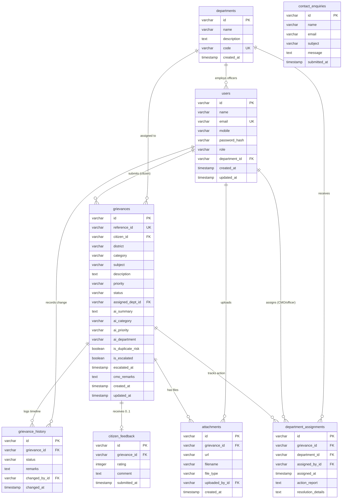

# 03 — Database Design

The portal persists all application data in **PostgreSQL 18** across **8 normalized tables** defined in [`backend/app/models/models.py`](../backend/app/models/models.py) and provisioned via Alembic migration [`001_initial_schema.py`](../backend/alembic/versions/001_initial_schema.py). Primary keys across all tables use UUID v4 strings (`str(uuid.uuid4())`).

---

## 1. Entity–Relationship Diagram (Mermaid)

---

## 2. Detailed Table Schemas

### 2.1 `users`
Stores all registered portal accounts (`CITIZEN`, `CMO_ADMIN`, `OFFICER`).

| Column | SQLAlchemy / PostgreSQL Type | Nullable | Default | Constraints / Indexes | Description |
| :--- | :--- | :--- | :--- | :--- | :--- |
| `id` | `String` (`VARCHAR`) | No | `gen_uuid()` | `PRIMARY KEY` | UUID v4 user identifier |
| `name` | `String(100)` | No | — | — | Full display name |
| `email` | `String(255)` | No | — | `UNIQUE`, `INDEX (ix_users_email)` | Normalized lowercase login email |
| `mobile` | `String(20)` | No | — | — | Contact phone number |
| `password_hash` | `String(255)` | No | — | — | Bcrypt hashed password |
| `role` | `String(20)` | No | `"CITIZEN"` | Application enum: `CITIZEN`, `CMO_ADMIN`, `OFFICER` | RBAC role |
| `department_id` | `String` (`VARCHAR`) | Yes | `NULL` | `FOREIGN KEY -> departments.id` | Populated for `OFFICER` accounts; `NULL` for Citizens/CMO |
| `created_at` | `DateTime` | Yes | `datetime.utcnow` | — | Account creation UTC timestamp |
| `updated_at` | `DateTime` | Yes | `datetime.utcnow` | Auto-updated `onupdate` | Last modification UTC timestamp |

---

### 2.2 `departments`
Master table of Kerala state departments participating in grievance redressal.

| Column | SQLAlchemy / PostgreSQL Type | Nullable | Default | Constraints / Indexes | Description |
| :--- | :--- | :--- | :--- | :--- | :--- |
| `id` | `String` (`VARCHAR`) | No | `gen_uuid()` | `PRIMARY KEY` | UUID v4 department identifier |
| `name` | `String(100)` | No | — | — | Official department name (e.g., `Public Works Department`) |
| `description` | `Text` | No | — | — | Scope and services handled |
| `code` | `String(20)` | No | — | `UNIQUE` | Short code (e.g., `PWD`, `HLTH`, `KSEB`) |
| `created_at` | `DateTime` | Yes | `datetime.utcnow` | — | Record creation UTC timestamp |

---

### 2.3 `grievances`
Core entity capturing citizen petitions, AI triage metadata, CMO remarks, escalation state, and current assignment.

| Column | SQLAlchemy / PostgreSQL Type | Nullable | Default | Constraints / Indexes | Description |
| :--- | :--- | :--- | :--- | :--- | :--- |
| `id` | `String` (`VARCHAR`) | No | `gen_uuid()` | `PRIMARY KEY` | UUID v4 grievance ID |
| `reference_id` | `String(30)` | No | — | `UNIQUE`, `INDEX (ix_grievances_reference_id)` | Human-readable tracker (`GRV-YYYYMMDD-XXXXX`) |
| `citizen_id` | `String` (`VARCHAR`) | No | — | `FOREIGN KEY -> users.id` | Authoring citizen |
| `district` | `String(100)` | No | — | — | One of Kerala's 14 districts |
| `category` | `String(100)` | No | — | — | Selected or AI-suggested grievance category |
| `subject` | `String(255)` | No | — | — | Short complaint headline |
| `description` | `Text` | No | — | — | Detailed complaint narrative |
| `priority` | `String(10)` | No | `"MEDIUM"` | Values: `LOW`, `MEDIUM`, `HIGH` | Active grievance priority |
| `status` | `String(20)` | No | `"SUBMITTED"` | Values: `SUBMITTED`, `UNDER_REVIEW`, `IN_PROGRESS`, `RESOLVED`, `REOPENED` | Current lifecycle status |
| `assigned_dept_id` | `String` (`VARCHAR`) | Yes | `NULL` | `FOREIGN KEY -> departments.id` | Currently assigned department |
| `ai_summary` | `Text` | Yes | `NULL` | — | AI-generated `<=100` char summary for CMO |
| `ai_category` | `String(100)` | Yes | `NULL` | — | Advisory AI category |
| `ai_priority` | `String(10)` | Yes | `NULL` | — | Advisory AI priority |
| `ai_department` | `String(100)` | Yes | `NULL` | — | Advisory AI department name |
| `is_duplicate_risk` | `Boolean` | Yes | `False` | — | Flag set when AI/keyword matching detects overlap |
| `is_escalated` | `Boolean` | Yes | `False` | — | True when escalated by CMO |
| `escalated_at` | `DateTime` | Yes | `NULL` | — | Timestamp of escalation action |
| `cmo_remarks` | `Text` | Yes | `NULL` | — | Official instructions/remarks from CMO |
| `created_at` | `DateTime` | Yes | `datetime.utcnow` | — | Submission UTC timestamp |
| `updated_at` | `DateTime` | Yes | `datetime.utcnow` | Auto-updated `onupdate` | Last update UTC timestamp |

---

### 2.4 `grievance_history`
Immutable chronological audit log of every submission, assignment, status update, escalation, and reopen event.

| Column | SQLAlchemy / PostgreSQL Type | Nullable | Default | Constraints / Indexes | Description |
| :--- | :--- | :--- | :--- | :--- | :--- |
| `id` | `String` (`VARCHAR`) | No | `gen_uuid()` | `PRIMARY KEY` | UUID v4 history entry ID |
| `grievance_id` | `String` (`VARCHAR`) | No | — | `FOREIGN KEY -> grievances.id` | Parent grievance |
| `status` | `String(20)` | No | — | — | Status recorded at this event |
| `remarks` | `Text` | Yes | `NULL` | — | Event note (e.g., forwarding note, reopen reason, escalation note) |
| `changed_by_id` | `String` (`VARCHAR`) | No | — | `FOREIGN KEY -> users.id` | User who triggered the event |
| `changed_at` | `DateTime` | Yes | `datetime.utcnow` | Ordered ascending on retrieval | Event UTC timestamp |

---

### 2.5 `department_assignments`
Tracks CMO-to-department forwarding records along with Department Officer field investigation reports and resolutions.

| Column | SQLAlchemy / PostgreSQL Type | Nullable | Default | Constraints / Indexes | Description |
| :--- | :--- | :--- | :--- | :--- | :--- |
| `id` | `String` (`VARCHAR`) | No | `gen_uuid()` | `PRIMARY KEY` | UUID v4 assignment ID |
| `grievance_id` | `String` (`VARCHAR`) | No | — | `FOREIGN KEY -> grievances.id` | Assigned grievance |
| `department_id` | `String` (`VARCHAR`) | No | — | `FOREIGN KEY -> departments.id` | Target department |
| `assigned_by_id` | `String` (`VARCHAR`) | No | — | `FOREIGN KEY -> users.id` | CMO admin (or acting officer on upsert) |
| `assigned_at` | `DateTime` | Yes | `datetime.utcnow` | — | Assignment UTC timestamp |
| `action_report` | `Text` | Yes | `NULL` | — | Officer site inspection & field findings |
| `resolution_details` | `Text` | Yes | `NULL` | — | Final completion & remediation notes |

---

### 2.6 `attachments`
Stores metadata and relative URLs for files uploaded by citizens or department officers.

| Column | SQLAlchemy / PostgreSQL Type | Nullable | Default | Constraints / Indexes | Description |
| :--- | :--- | :--- | :--- | :--- | :--- |
| `id` | `String` (`VARCHAR`) | No | `gen_uuid()` | `PRIMARY KEY` | UUID v4 attachment ID |
| `grievance_id` | `String` (`VARCHAR`) | No | — | `FOREIGN KEY -> grievances.id` | Related grievance |
| `url` | `String(500)` | No | — | — | Served path (e.g., `/uploads/1762870000-123456.pdf`) |
| `filename` | `String(255)` | No | — | — | Original client filename |
| `file_type` | `String(100)` | No | — | — | MIME type (fallback `application/octet-stream`) |
| `uploaded_by_id` | `String` (`VARCHAR`) | No | — | `FOREIGN KEY -> users.id` | Uploading citizen, officer, or CMO user |
| `created_at` | `DateTime` | Yes | `datetime.utcnow` | — | Upload UTC timestamp |

---

### 2.7 `citizen_feedback`
One-to-one post-resolution rating and review submitted by the owning citizen when a grievance reaches `RESOLVED`.

| Column | SQLAlchemy / PostgreSQL Type | Nullable | Default | Constraints / Indexes | Description |
| :--- | :--- | :--- | :--- | :--- | :--- |
| `id` | `String` (`VARCHAR`) | No | `gen_uuid()` | `PRIMARY KEY` | UUID v4 feedback ID |
| `grievance_id` | `String` (`VARCHAR`) | No | — | `FOREIGN KEY -> grievances.id`, `UNIQUE` | Enforces max 1 feedback row per grievance (upserted on resubmit) |
| `rating` | `Integer` | No | — | Controller validated `1 <= rating <= 5` | Citizen star rating |
| `comment` | `Text` | Yes | `NULL` | — | Optional qualitative comment |
| `submitted_at` | `DateTime` | Yes | `datetime.utcnow` | — | Submission UTC timestamp |

---

### 2.8 `contact_enquiries`
Stores public enquiry messages submitted via the `/contact` page.

| Column | SQLAlchemy / PostgreSQL Type | Nullable | Default | Constraints / Indexes | Description |
| :--- | :--- | :--- | :--- | :--- | :--- |
| `id` | `String` (`VARCHAR`) | No | `gen_uuid()` | `PRIMARY KEY` | UUID v4 enquiry ID |
| `name` | `String(100)` | No | — | — | Sender name |
| `email` | `String(255)` | No | — | — | Sender email |
| `subject` | `String(255)` | No | — | — | Enquiry subject |
| `message` | `Text` | No | — | — | Enquiry message body |
| `submitted_at` | `DateTime` | Yes | `datetime.utcnow` | — | Submission UTC timestamp |

---

## 3. Relationships, Constraints & Indexes Summary

| Relationship | Cardinality | Foreign Key Mapping | Behavior |
| :--- | :--- | :--- | :--- |
| `Department -> User` | `1 : N` | `users.department_id -> departments.id` | Links officers to their assigned department (`NULL` for Citizens/CMO). |
| `User -> Grievance` | `1 : N` | `grievances.citizen_id -> users.id` | Ownership tracking for citizen dashboard and `403` isolation. |
| `Department -> Grievance` | `1 : N` | `grievances.assigned_dept_id -> departments.id` | Current department responsible for the grievance. |
| `Grievance -> GrievanceHistory` | `1 : N` | `grievance_history.grievance_id -> grievances.id` | Ordered chronologically (`order_by="GrievanceHistory.changed_at"`). |
| `Grievance -> DepartmentAssignment` | `1 : N` | `department_assignments.grievance_id -> grievances.id` | Supports re-assignment history and stores `action_report` / `resolution_details`. |
| `Grievance -> Attachment` | `1 : N` | `attachments.grievance_id -> grievances.id` | Supports multiple citizen & officer uploads per case. |
| `Grievance -> CitizenFeedback` | `1 : 0..1` | `citizen_feedback.grievance_id -> grievances.id` | Unique constraint guarantees one feedback record per grievance (`uselist=False`), updated via upsert. |

### Indexes & Unique Constraints
- `ix_users_email` (`UNIQUE` B-tree index on `users.email`) — Fast login lookups and duplicate registration prevention (`409 Conflict`).
- `ix_grievances_reference_id` (`UNIQUE` B-tree index on `grievances.reference_id`) — Fast public tracking lookups (`GET /api/grievances/track/{ref_id}`).
- `departments.code` (`UNIQUE` constraint) — Guarantees canonical department short codes (`PWD`, `HLTH`, `EDU`, `REV`, `WTR`, `KSEB`, `AGRI`, `TRNS`, `FRST`, `SWD`).
- `citizen_feedback.grievance_id` (`UNIQUE` constraint) — Enforces 1:1 feedback cardinality.

---

## 4. Seed Data Profile (`backend/seed.py`)

Running `python seed.py` idempotently populates the database with:
- **10 Departments:** `PWD`, `HLTH`, `EDU`, `REV`, `WTR`, `KSEB`, `AGRI`, `TRNS`, `FRST`, `SWD`.
- **4 Demo Users:** 1 Citizen (`citizen@demo.com`), 1 CMO Admin (`cmo@demo.com`), and 2 Officers (`officer@demo.com` in `PWD`, `health.officer@demo.com` in `HLTH`).
- **15 Sample Grievances:** Covering **all 14 Kerala districts** (`GRV-20261101-TVM01` through `GRV-20261115-TVM15`), all **5 statuses** (`SUBMITTED`, `UNDER_REVIEW`, `IN_PROGRESS`, `RESOLVED`, `REOPENED`), **overdue cases (`>7 days`)**, **2 pre-escalated records**, action reports, resolution details, and **4 citizen feedback entries**.
