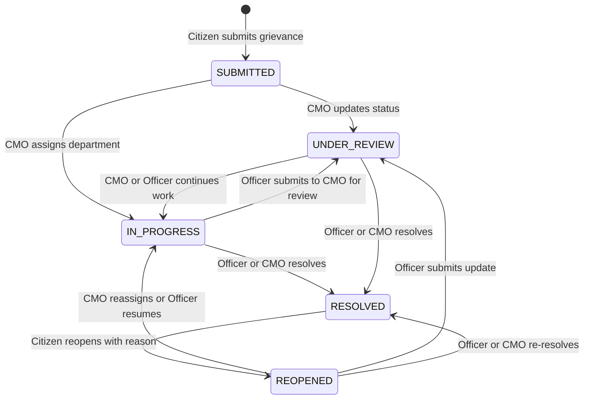

# 04 — REST API Documentation

- **Base URL (Local Development):** `http://localhost:8000`
- **Interactive Swagger UI:** `http://localhost:8000/docs`
- **ReDoc UI:** `http://localhost:8000/redoc`
- **Content-Type:** `application/json` (except `POST /api/grievances/{id}/attachments`, which uses `multipart/form-data`)

---

## 1. Authentication & Standard Envelopes

### Authentication Header
Protected endpoints require a Bearer JWT acquired via `POST /api/auth/register` or `POST /api/auth/login`:
```http
Authorization: Bearer <jwt_token>
```

### Standard Response Envelopes
- **Success:** `{"success": true, "data": <object | array>, "message": "<optional>"}`
- **HTTP Error (`400`, `401`, `403`, `404`, `409`):**
  ```json
  {
    "success": false,
    "message": "Access denied",
    "detail": "Access denied"
  }
  ```
- **Validation Error (`422 Unprocessable Entity`):** FastAPI Pydantic validation detail array when malformed types or missing required JSON fields are sent.

### Grievance Status Lifecycle



---

## 2. Endpoint Summary Matrix (25 REST Endpoints + Static Mount)

| Group | Method & Path | Auth / Role | Purpose |
| :--- | :--- | :--- | :--- |
| **System** | `GET /api/health` | Public | Service health check |
| **Public Stats** | `GET /api/stats/public` | Public | Aggregate portal KPIs |
| **Departments** | `GET /api/departments` | Public | List all Kerala state departments |
| **Contact** | `POST /api/contact` | Public | Submit contact enquiry |
| **Auth** | `POST /api/auth/register` | Public | Register Citizen account & issue JWT |
| **Auth** | `POST /api/auth/login` | Public | Authenticate any role & issue JWT |
| **Auth** | `GET /api/auth/me` | Any Authenticated | Get current user profile + department |
| **AI** | `POST /api/ai/analyze` | Any Authenticated | AI classification & duplicate check |
| **Grievances** | `POST /api/grievances` | `CITIZEN` | Submit new grievance |
| **Grievances** | `GET /api/grievances/my` | `CITIZEN` | List citizen's own grievances |
| **Grievances** | `GET /api/grievances/track/{ref_id}` | Public | Track grievance by Reference ID |
| **Grievances** | `GET /api/grievances/{id}` | Scoped Authenticated | Get grievance details (owner / assigned dept / CMO) |
| **Grievances** | `POST /api/grievances/{id}/reopen` | `CITIZEN` (Owner) | Reopen a `RESOLVED` grievance |
| **Grievances** | `POST /api/grievances/{id}/feedback` | `CITIZEN` (Owner) | Submit/update 1–5 star rating & comment |
| **Grievances** | `POST /api/grievances/{id}/attachments` | Scoped Authenticated | Upload file attachment (`<= 5 MB`) |
| **CMO Admin** | `GET /api/cmo/grievances` | `CMO_ADMIN` | Paginated, filtered grievance list |
| **CMO Admin** | `GET /api/cmo/stats` | `CMO_ADMIN` | Statewide stats & breakdown charts |
| **CMO Admin** | `GET /api/cmo/grievances/{id}` | `CMO_ADMIN` | Full grievance view (incl. citizen mobile) |
| **CMO Admin** | `PATCH /api/cmo/grievances/{id}/assign` | `CMO_ADMIN` | Assign department & set `IN_PROGRESS` |
| **CMO Admin** | `PATCH /api/cmo/grievances/{id}/remarks` | `CMO_ADMIN` | Save official CMO remarks |
| **CMO Admin** | `PATCH /api/cmo/grievances/{id}/status` | `CMO_ADMIN` | Update status & append history |
| **CMO Admin** | `PATCH /api/cmo/grievances/{id}/escalate` | `CMO_ADMIN` | Escalate case to `HIGH` priority |
| **Officer** | `GET /api/officer/grievances` | `OFFICER` | List department's assigned grievances |
| **Officer** | `GET /api/officer/grievances/{id}` | `OFFICER` | View department-assigned grievance detail |
| **Officer** | `PATCH /api/officer/grievances/{id}/update` | `OFFICER` | Update status, remarks, action & resolution reports |
| **Static Files** | `GET /uploads/{filename}` | Public (Static mount) | Retrieve uploaded evidence files |

---

## 3. System, Departments, Stats & Contact Endpoints

### 3.1 `GET /api/health`
Health verification endpoint.
- **Auth:** Public
- **Response (`200 OK`):**
  ```json
  {
    "success": true,
    "message": "CM Kerala API running",
    "version": "1.0.0"
  }
  ```

### 3.2 `GET /api/stats/public`
Returns public aggregate counts displayed on the Home Page stats bar.
- **Auth:** Public
- **Response (`200 OK`):**
  ```json
  {
    "success": true,
    "data": {
      "total": 15,
      "resolved": 4,
      "pending": 11,
      "departments_count": 10
    }
  }
  ```

### 3.3 `GET /api/departments`
Lists all Kerala state departments sorted alphabetically by `name`. (Both `/api/departments` and `/api/departments/` are registered without redirect.)
- **Auth:** Public
- **Response (`200 OK`):**
  ```json
  {
    "success": true,
    "data": [
      {
        "id": "b62f1a88-3f24-482b-9d1a-1234567890ab",
        "name": "Agriculture Department",
        "description": "Crop insurance, paddy procurement, farmer subsidies, soil testing, and Krishi Bhavan services.",
        "code": "AGRI",
        "created_at": "2026-11-11T10:15:00"
      }
    ]
  }
  ```

### 3.4 `POST /api/contact`
Persists a public enquiry into `contact_enquiries`.
- **Auth:** Public
- **Request Body:**
  ```json
  {
    "name": "Anjali Menon",
    "email": "anjali@example.com",
    "subject": "Document format question",
    "message": "Can I upload multiple photos for a single grievance?"
  }
  ```
- **Response (`201 Created`):**
  ```json
  {
    "success": true,
    "data": {
      "id": "e48e3b20-5e77-4f82-a311-62b1dc6f8b12",
      "name": "Anjali Menon",
      "email": "anjali@example.com",
      "subject": "Document format question",
      "message": "Can I upload multiple photos for a single grievance?",
      "submitted_at": "2026-11-11T10:25:10.123456"
    },
    "message": "Your message has been sent"
  }
  ```
- **Errors:** `400 Bad Request` (`"All fields required"`) if any trimmed string is empty.

---

## 4. Authentication Endpoints (`/api/auth`)

### 4.1 `POST /api/auth/register`
Creates a new `CITIZEN` user and immediately issues an access JWT.
- **Auth:** Public
- **Request Body:**
  ```json
  {
    "name": "Anjali Menon",
    "email": "anjali@example.com",
    "mobile": "9847011223",
    "password": "Password@123"
  }
  ```
- **Response (`201 Created`):**
  ```json
  {
    "success": true,
    "data": {
      "token": "<jwt_token>",
      "user": {
        "id": "7d1a5e10-2e30-4f89-9d55-908a3b6c1a22",
        "name": "Anjali Menon",
        "email": "anjali@example.com",
        "role": "CITIZEN",
        "department_id": null,
        "created_at": "2026-11-11T10:30:00.000000"
      }
    }
  }
  ```
- **Errors:**
  - `400 Bad Request`: `"All fields required"`
  - `409 Conflict`: `"Email already registered"`

### 4.2 `POST /api/auth/login`
Authenticates any role (`CITIZEN`, `CMO_ADMIN`, `OFFICER`) and issues a JWT containing `{id, email, role, department_id}`.
- **Auth:** Public
- **Request Body:**
  ```json
  {
    "email": "citizen@demo.com",
    "password": "Demo@1234"
  }
  ```
- **Response (`200 OK`):** Same envelope as `/register`.
- **Errors:** `401 Unauthorized` (`"Invalid credentials"`).

### 4.3 `GET /api/auth/me`
Returns the authenticated user's profile and department name (for officers).
- **Auth:** Bearer JWT (any role)
- **Headers:** `Authorization: Bearer <token>`
- **Response (`200 OK`):**
  ```json
  {
    "success": true,
    "data": {
      "id": "a1b2c3d4-...",
      "name": "Suresh Kumar",
      "email": "officer@demo.com",
      "mobile": "9847098765",
      "role": "OFFICER",
      "department_id": "dept-uuid-...",
      "created_at": "2026-11-11T10:00:00",
      "department": {
        "name": "Public Works Department"
      }
    }
  }
  ```
- **Errors:** `401 Unauthorized` (`"Invalid or expired token"` or `"User not found"`).

---

## 5. AI Assistant Endpoint (`/api/ai`)

### 5.1 `POST /api/ai/analyze`
Analyzes a draft grievance description using Groq `openai/gpt-oss-120b` (with fallback classifier) and checks recent PostgreSQL grievances for duplicate risk.
- **Auth:** Bearer JWT (any role)
- **Headers:** `Authorization: Bearer <token>`
- **Request Body:**
  ```json
  {
    "description": "Severe potholes and waterlogging near Kazhakootam Technopark junction causing daily accidents."
  }
  ```
- **Response (`200 OK`):**
  ```json
  {
    "success": true,
    "data": {
      "department": "Public Works Department",
      "category": "Roads & Infrastructure",
      "priority": "HIGH",
      "summary": "Severe potholes and waterlogging near Kazhakootam junction causing accidents",
      "is_duplicate_risk": true,
      "duplicate_candidates": [
        {
          "reference_id": "GRV-20261101-TVM01",
          "subject": "Severe potholes and waterlogging near Kazhakootam bypass",
          "status": "IN_PROGRESS"
        }
      ],
      "model_used": "openai/gpt-oss-120b",
      "is_fallback": false
    }
  }
  ```
- **Errors:** `400 Bad Request` (`"Description too short"` when trimmed length `< 10` characters).

---

## 6. Citizen & Public Grievance Endpoints (`/api/grievances`)

### 6.1 `POST /api/grievances`
Creates a new grievance in `SUBMITTED` status, generates a unique `reference_id` (`GRV-YYYYMMDD-XXXXX`), and inserts the initial `grievance_history` entry.
- **Auth:** Bearer JWT (`CITIZEN` only)
- **Request Body:**
  ```json
  {
    "district": "Ernakulam",
    "category": "Water Supply & Sanitation",
    "subject": "Broken water main flooding street in Kakkanad",
    "description": "A 6-inch drinking water distribution pipe burst near InfoPark Phase 2 gate 3 days ago.",
    "priority": "HIGH",
    "ai_summary": "Broken drinking water main near InfoPark Kakkanad flooding street",
    "ai_category": "Water Supply & Sanitation",
    "ai_priority": "HIGH",
    "ai_department": "Water Resources",
    "is_duplicate_risk": false
  }
  ```
- **Response (`201 Created`):**
  ```json
  {
    "success": true,
    "data": {
      "id": "grievance-uuid",
      "reference_id": "GRV-20261111-K8P2M",
      "citizen_id": "citizen-uuid",
      "district": "Ernakulam",
      "category": "Water Supply & Sanitation",
      "subject": "Broken water main flooding street in Kakkanad",
      "description": "A 6-inch drinking water distribution pipe burst near InfoPark Phase 2 gate 3 days ago.",
      "priority": "HIGH",
      "status": "SUBMITTED",
      "assigned_dept_id": null,
      "ai_summary": "Broken drinking water main near InfoPark Kakkanad flooding street",
      "ai_category": "Water Supply & Sanitation",
      "ai_priority": "HIGH",
      "ai_department": "Water Resources",
      "is_duplicate_risk": false,
      "is_escalated": false,
      "escalated_at": null,
      "cmo_remarks": null,
      "created_at": "2026-11-11T11:05:00",
      "updated_at": "2026-11-11T11:05:00"
    },
    "message": "Grievance submitted. Reference ID: GRV-20261111-K8P2M"
  }
  ```
- **Errors:** `400 Bad Request` (`"Missing required fields"`), `403 Forbidden` if non-citizen.

### 6.2 `GET /api/grievances/my`
Lists all grievances submitted by the currently authenticated citizen, ordered newest first, including `assigned_dept` and `history`.
- **Auth:** Bearer JWT (`CITIZEN` only)
- **Response (`200 OK`):**
  ```json
  {
    "success": true,
    "data": [
      {
        "id": "grievance-uuid",
        "reference_id": "GRV-20261101-TVM01",
        "district": "Thiruvananthapuram",
        "subject": "Severe potholes and waterlogging near Kazhakootam bypass",
        "priority": "HIGH",
        "status": "IN_PROGRESS",
        "assigned_dept": {
          "id": "pwd-uuid",
          "name": "Public Works Department",
          "description": "...",
          "code": "PWD"
        },
        "history": [ ... ]
      }
    ]
  }
  ```

### 6.3 `GET /api/grievances/track/{ref_id}`
Public tracking endpoint returning grievance details, `citizen` (`id`, `name`, `email` — mobile excluded), `assigned_dept`, `history`, `attachments`, and `feedback`.
- **Auth:** Public
- **Path Parameter:** `ref_id` — e.g. `GRV-20261101-TVM01`
- **Response (`200 OK`):**
  ```json
  {
    "success": true,
    "data": {
      "id": "grievance-uuid",
      "reference_id": "GRV-20261101-TVM01",
      "status": "IN_PROGRESS",
      "priority": "HIGH",
      "district": "Thiruvananthapuram",
      "citizen": { "id": "...", "name": "Rahul Nair", "email": "citizen@demo.com" },
      "assigned_dept": { "id": "...", "name": "Public Works Department", "code": "PWD" },
      "history": [
        {
          "id": "...",
          "status": "SUBMITTED",
          "remarks": "Grievance submitted by citizen",
          "changed_at": "2026-11-01T10:00:00",
          "changed_by": { "name": "Rahul Nair", "role": "CITIZEN" }
        }
      ],
      "attachments": [],
      "feedback": null
    }
  }
  ```
- **Errors:** `404 Not Found` (`"Grievance not found"`).

### 6.4 `GET /api/grievances/{id}`
Returns complete grievance details including `assignments` and `feedback`, scoped by caller role:
- `CITIZEN`: allowed only if `grievance.citizen_id == current_user.id`
- `OFFICER`: allowed only if `grievance.assigned_dept_id == current_user.department_id`
- `CMO_ADMIN`: unrestricted
- **Auth:** Bearer JWT (any role)
- **Path Parameter:** `id` — Grievance UUID
- **Errors:** `403 Forbidden` (`"Access denied"`), `404 Not Found`.

### 6.5 `POST /api/grievances/{id}/reopen`
Reopens a `RESOLVED` grievance belonging to the authenticated citizen, sets `status = "REOPENED"`, and logs the reason in `grievance_history`.
- **Auth:** Bearer JWT (`CITIZEN` owner only)
- **Request Body:**
  ```json
  {
    "reason": "Streetlights in Sector 2 stopped working again after heavy rain."
  }
  ```
- **Response (`200 OK`):** Returns updated grievance with `assigned_dept`, `history`, `assignments`, `feedback`, and `"message": "Grievance reopened"`.
- **Errors:** `400 Bad Request` (`"Reopen reason is required"` or `"Only resolved grievances can be reopened"`), `404 Not Found`.

### 6.6 `POST /api/grievances/{id}/feedback`
Creates or updates (`upsert`) the citizen's 1–5 star rating and optional comment on a `RESOLVED` grievance they own.
- **Auth:** Bearer JWT (`CITIZEN` owner only)
- **Request Body:**
  ```json
  {
    "rating": 5,
    "comment": "Prompt action taken by the department."
  }
  ```
- **Response (`200 OK`):**
  ```json
  {
    "success": true,
    "data": {
      "id": "feedback-uuid",
      "grievance_id": "grievance-uuid",
      "rating": 5,
      "comment": "Prompt action taken by the department.",
      "submitted_at": "2026-11-11T12:10:00"
    }
  }
  ```
- **Errors:** `400 Bad Request` (`"Can only give feedback on resolved grievances"` or `"Rating must be between 1 and 5"`), `404 Not Found`.

### 6.7 `POST /api/grievances/{id}/attachments`
Uploads a supporting document or photo (`<= 5 MB`) for a grievance. Allowed extensions: `.jpeg`, `.jpg`, `.png`, `.gif`, `.pdf`, `.doc`, `.docx`, `.txt`.
- **Auth:** Bearer JWT (`CITIZEN` owner, assigned `OFFICER`, or `CMO_ADMIN`)
- **Headers:** `Authorization: Bearer <token>`, `Content-Type: multipart/form-data`
- **Form Field:** `file` (binary file)
- **Response (`200 OK`):**
  ```json
  {
    "success": true,
    "data": {
      "id": "attachment-uuid",
      "grievance_id": "grievance-uuid",
      "url": "/uploads/1762870000123-456789.jpg",
      "filename": "road_damage.jpg",
      "file_type": "image/jpeg",
      "uploaded_by_id": "user-uuid",
      "created_at": "2026-11-11T11:06:00"
    }
  }
  ```
- **Errors:** `400 Bad Request` (`"Invalid file type"` or `"File size exceeds 5MB limit"`), `403 Forbidden`, `404 Not Found`.

---

## 7. CMO Admin Endpoints (`/api/cmo`)

All `/api/cmo/*` endpoints require `Authorization: Bearer <token>` with `role = "CMO_ADMIN"`. Non-CMO callers receive `403 Forbidden`.

### 7.1 `GET /api/cmo/grievances`
Returns paginated grievances filtered by optional criteria, including citizen contact info (`name`, `email`, `mobile`) and `assigned_dept`.
- **Query Parameters:**
  - `district` (string, optional)
  - `category` (string, optional)
  - `priority` (`LOW` | `MEDIUM` | `HIGH`, optional)
  - `status` (`SUBMITTED` | `UNDER_REVIEW` | `IN_PROGRESS` | `RESOLVED` | `REOPENED`, optional)
  - `page` (int, default `1`, min `1`)
  - `limit` (int, default `20`, range `1..100`)
- **Response (`200 OK`):**
  ```json
  {
    "success": true,
    "data": {
      "grievances": [ ... ],
      "total": 15,
      "page": 1,
      "limit": 20
    }
  }
  ```

### 7.2 `GET /api/cmo/stats`
Returns statewide dashboard KPIs and chart breakdowns. (`overdue` counts non-resolved cases created more than 7 days ago.)
- **Response (`200 OK`):**
  ```json
  {
    "success": true,
    "data": {
      "total": 15,
      "pending": 11,
      "resolved": 4,
      "overdue": 6,
      "escalated": 2,
      "by_status": [
        { "status": "IN_PROGRESS", "count": 4 },
        { "status": "RESOLVED", "count": 4 }
      ],
      "by_district": [
        { "district": "Thiruvananthapuram", "count": 2 }
      ],
      "by_department": [
        { "department": "Public Works Department", "count": 4 }
      ]
    }
  }
  ```

### 7.3 `GET /api/cmo/grievances/{id}`
Returns full grievance detail including `citizen` (with `mobile`), `assigned_dept`, `history`, `attachments`, `assignments`, and `feedback`.
- **Errors:** `404 Not Found` (`"Grievance not found"`).

### 7.4 `PATCH /api/cmo/grievances/{id}/assign`
Assigns a grievance to a state department, sets `status = "IN_PROGRESS"`, creates a `department_assignments` row, and logs a `grievance_history` entry.
- **Request Body:**
  ```json
  {
    "department_id": "dept-uuid",
    "remarks": "Conduct urgent inspection and deploy repair crew."
  }
  ```
- **Response (`200 OK`):** Returns updated grievance with `"message": "Grievance assigned to Public Works Department"`.
- **Errors:** `404 Not Found` (if grievance or department missing).

### 7.5 `PATCH /api/cmo/grievances/{id}/remarks`
Saves or updates official `cmo_remarks` on the grievance.
- **Request Body:**
  ```json
  {
    "remarks": "Priority repair requested before monsoon intensification."
  }
  ```
- **Response (`200 OK`):** `{"success": true, "data": { ...grievance... }}`.

### 7.6 `PATCH /api/cmo/grievances/{id}/status`
Manually overrides grievance `status` (`SUBMITTED`, `UNDER_REVIEW`, `IN_PROGRESS`, `RESOLVED`, `REOPENED`) and appends a `grievance_history` entry.
- **Request Body:**
  ```json
  {
    "status": "UNDER_REVIEW",
    "remarks": "CMO Secretariat examining field feasibility."
  }
  ```
- **Response (`200 OK`):** `{"success": true, "data": { ...grievance with history... }}`.
- **Errors:** `400 Bad Request` (`"Invalid status"`), `404 Not Found`.

### 7.7 `PATCH /api/cmo/grievances/{id}/escalate`
Flags `is_escalated = true`, sets `escalated_at = utcnow()`, upgrades `priority = "HIGH"`, and logs an entry in `grievance_history`.
- **Request Body:**
  ```json
  {
    "remarks": "Escalated by CMO due to delay beyond 7-day SLA."
  }
  ```
- **Response (`200 OK`):** Returns updated grievance with `"message": "Grievance escalated to HIGH priority"`.

---

## 8. Department Officer Endpoints (`/api/officer`)

All `/api/officer/*` endpoints require `Authorization: Bearer <token>` with `role = "OFFICER"`. Queries are strictly scoped to `current_user.department_id`.

### 8.1 `GET /api/officer/grievances`
Lists grievances assigned to the officer's department. Without `status`, returns cases in `IN_PROGRESS`, `UNDER_REVIEW`, `REOPENED`, or `RESOLVED`.
- **Query Parameter:** `status` (optional — e.g. `IN_PROGRESS`, `UNDER_REVIEW`, `REOPENED`, `RESOLVED`)
- **Response (`200 OK`):** `{"success": true, "data": [ ...grievances with citizen, assigned_dept, history... ]}`
- **Errors:** `400 Bad Request` (`"No department assigned"` if officer user lacks `department_id`).

### 8.2 `GET /api/officer/grievances/{id}`
Retrieves a single grievance assigned to the officer's department (`citizen`, `assigned_dept`, `history`, `attachments`, `assignments`).
- **Errors:** `400 Bad Request` (`"No department assigned"`), `404 Not Found` (`"Grievance not found"` if nonexistent or assigned to another department).

### 8.3 `PATCH /api/officer/grievances/{id}/update`
Updates status (`IN_PROGRESS`, `UNDER_REVIEW`, `RESOLVED`, `REOPENED`), logs history remarks, and updates `action_report` and/or `resolution_details` on the department assignment record.
- **Request Body (all fields optional):**
  ```json
  {
    "status": "RESOLVED",
    "remarks": "Drainage desilted and road resurfaced.",
    "action_report": "Site inspection completed by Assistant Engineer. Patch material laid across 150m stretch.",
    "resolution_details": "Road repaired and open to traffic; waterlogging cleared."
  }
  ```
- **Response (`200 OK`):**
  ```json
  {
    "success": true,
    "message": "Grievance updated successfully"
  }
  ```
- **Errors:** `400 Bad Request` (`"Invalid status"` or `"No department assigned"`), `404 Not Found`.
