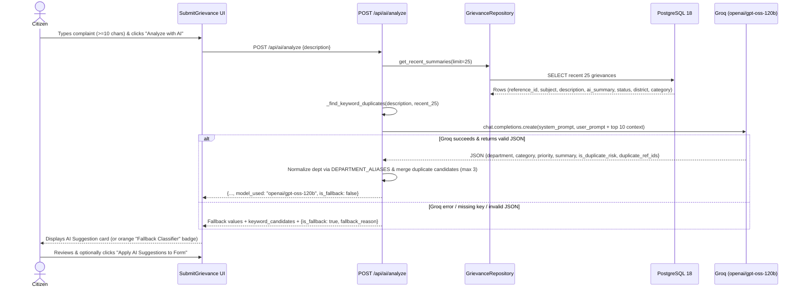
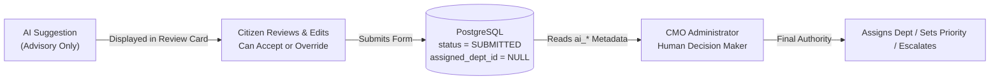

# 05 — AI Integration Architecture (`openai/gpt-oss-120b` via Groq)

The AI Grievance Assistant accelerates grievance triage while preserving strict **human-in-the-loop (HITL)** governance. Implementation lives in [`backend/app/services/ai_service.py`](../backend/app/services/ai_service.py), [`backend/app/controllers/ai_controller.py`](../backend/app/controllers/ai_controller.py), and [`frontend/src/pages/citizen/SubmitGrievance.tsx`](../frontend/src/pages/citizen/SubmitGrievance.tsx).

---

## 1. Model & Provider Configuration

| Setting | Value | Source |
| :--- | :--- | :--- |
| **Model Identifier** | `openai/gpt-oss-120b` | `MODEL_NAME` in `ai_service.py` |
| **Inference Provider** | Groq Cloud (`https://api.groq.com/openai/v1`) | `AsyncOpenAI(api_key=settings.GROQ_API_KEY, base_url=...)` |
| **Temperature** | `0.2` | Low variance for deterministic structured triage |
| **Max Tokens** | `1024` | Accommodates reasoning + strict JSON payload |
| **Structured Output** | `response_format={"type": "json_object"}` | Forces valid JSON emission |

---

## 2. End-to-End Triage & Duplicate Detection Pipeline



---

## 3. System & User Prompt Design

### 3.1 System Prompt
```text
You are an AI assistant for the Kerala CM Grievance Portal. Analyze grievances and return ONLY valid JSON, no markdown or extra text. Available departments (choose exact name): Public Works Department, Health Services, Education Department, Revenue Department, Water Resources, Kerala State Electricity Board, Agriculture Department, Transport Department, Forest Department, Social Welfare Department. Priority: LOW=minor, MEDIUM=daily life impact, HIGH=urgent/safety. If the new grievance strongly overlaps with any recent existing grievances, set is_duplicate_risk=true and list matching reference_ids in duplicate_ref_ids.
```

### 3.2 User Prompt Template
When recent grievances exist in PostgreSQL, the top 10 are appended as `recent_context`:
```text
Analyze this grievance: "{description}"
Recent existing grievances for duplicate checking:
- GRV-20261101-TVM01 [IN_PROGRESS] (Thiruvananthapuram): Severe potholes and waterlogging near Kazhakootam bypass
...
Return ONLY valid JSON: {"department":"<exact department name>","category":"<short category>","priority":"LOW|MEDIUM|HIGH","summary":"<max 100 chars>","is_duplicate_risk":false,"duplicate_ref_ids":[]}
```

### 3.3 Department Alias Normalization
To guarantee consistency with the 10 seeded PostgreSQL `departments` rows even if the LLM emits shorthand, `_normalize_department()` maps aliases (`DEPARTMENT_ALIASES`) and substring matches:
- `"pwd"`, `"public works"` -> `"Public Works Department"`
- `"kseb"`, `"electricity"`, `"electricity board"` -> `"Kerala State Electricity Board"`
- `"health"` -> `"Health Services"`
- `"water"` -> `"Water Resources"`
- `"forest"` -> `"Forest Department"`, `"social welfare"` -> `"Social Welfare Department"`, etc.
- Defaults safely to `"Public Works Department"` if unrecognized.

---

## 4. Input & Output Schemas

### Request Schema (`AIAnalyzeRequest`)
```json
{
  "description": "Minimum 10 characters describing the civic issue"
}
```
Validated in `ai_controller.py`: raises `400 Bad Request` (`"Description too short"`) if `len(description.strip()) < 10`.

### Response Schema (`data` inside `POST /api/ai/analyze`)
| Field | Type | Constraints / Semantics |
| :--- | :--- | :--- |
| `department` | `string` | One of the 10 canonical Kerala department names |
| `category` | `string` | Truncated to max `100` characters |
| `priority` | `"LOW" \| "MEDIUM" \| "HIGH"` | Normalized uppercase; defaults to `"MEDIUM"` if invalid |
| `summary` | `string` | Truncated to max `100` characters for quick CMO scanning |
| `is_duplicate_risk` | `boolean` | `true` if LLM flagged overlap OR `len(duplicate_candidates) > 0` |
| `duplicate_candidates` | `Array<{reference_id, subject, status}>` | Up to 3 merged matches (LLM + keyword overlap) |
| `model_used` | `string` | `"openai/gpt-oss-120b"` |
| `is_fallback` | `boolean` | `false` for live Groq response; `true` when fallback classifier ran |
| `fallback_reason` | `string` *(optional)* | Present only when `is_fallback: true` (exception message) |

---

## 5. Hybrid Duplicate Detection Against Database Context

Rather than relying solely on the LLM (which could hallucinate reference IDs or miss exact matches if the API is down), `ai_service.py` combines **two complementary signals**:

1. **Deterministic Keyword Overlap (`_find_keyword_duplicates`):**
   - Tokenizes alphabetic words of length `>= 4` (`re.findall(r"[a-zA-Z]{4,}", text.lower())`), filtering out common domain stopwords (`"kerala"`, `"issue"`, `"problem"`, `"grievance"`, `"complaint"`, `"please"`, `"kindly"`, etc.).
   - Compares the incoming draft against the **25 most recent grievances** (`subject + description + ai_summary`) from PostgreSQL.
   - Flags a candidate when token overlap satisfies:
     - `len(overlap) >= 3`, **OR**
     - `len(overlap) >= 2` and Jaccard similarity `len(overlap) / len(desc_tokens | g_tokens) >= 0.15`.
2. **LLM Semantic Matching:**
   - The LLM inspects the top 10 recent grievance summaries and emits `duplicate_ref_ids`.
   - The backend verifies each returned `ref_id` against `recent_by_ref` (preventing hallucinated reference IDs), merges them with keyword candidates without duplicates, and caps the list at 3 items.

---

## 6. Human-in-the-Loop (HITL) Safeguards

This system enforces **strictly non-autonomous AI decision-making** at every stage:



1. **No Auto-Submission or Auto-Routing:** Calling `/api/ai/analyze` never creates a database row and never assigns a department (`assigned_dept_id` remains `NULL` on `POST /api/grievances`).
2. **Explicit Citizen Opt-In:** In `SubmitGrievance.tsx`, AI output appears in a distinct amber preview card titled *"AI Suggestion (Review before submitting)"*. Nothing in the form changes until the citizen clicks **"Apply AI Suggestions to Form"**, and all form inputs (`category`, `priority`, `district`, `subject`, `description`) remain freely editable afterward.
3. **Advisory Metadata Separation:** The `grievances` table preserves citizen-chosen values (`category`, `priority`, `assigned_dept_id`) separately from advisory AI columns (`ai_summary`, `ai_category`, `ai_priority`, `ai_department`, `is_duplicate_risk`).
4. **CMO Human Oversight:** On `/cmo/grievances/:id`, the CMO Administrator views the **AI Triage Assessment** card (including any **Duplicate Risk Flagged** alert) purely as decision support before manually selecting the target department and priority/status.

---

## 7. Labelled Fallback Mechanism

If Groq inference fails for any reason—missing/invalid `GROQ_API_KEY`, network outage, rate limit, timeout, or non-JSON model output—the exception is caught cleanly in `analyze_grievance()` so citizen grievance submission is **never blocked**:

- **Fallback Payload:**
  ```json
  {
    "department": "Public Works Department",
    "category": "General",
    "priority": "MEDIUM",
    "summary": "<first 100 chars of description>",
    "is_duplicate_risk": "<boolean from local keyword matcher>",
    "duplicate_candidates": [ "...local keyword matches if any..." ],
    "model_used": "openai/gpt-oss-120b",
    "is_fallback": true,
    "fallback_reason": "<exception message>"
  }
  ```
- **Transparent UI Labelling:** The frontend renders an orange **`Fallback Classifier`** pill badge (instead of the green `AI (openai/gpt-oss-120b)` badge), displays `Note: <fallback_reason>`, and displays a toast `"Fallback classification generated"` so users are never misled into believing live LLM inference ran.
