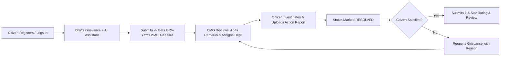

# 07 — Role-Based User Guide

Welcome to the **CM Kerala Public Grievance Redressal Portal** User Guide. This walkthrough explains every portal workflow organized by role: **Public Visitor**, **Citizen**, **CMO Administrator**, and **Department Officer**.

> 🎥 **Video Walkthrough Demonstration (4:26 mins):** [Watch Demo Video on Google Drive](https://drive.google.com/file/d/1X7DGp7Q0t7qOI2nsFpAZmmmpsQMMLWTh/view?usp=sharing)

---

## End-to-End Portal Journey Overview

---

## 1. Public Visitor Guide (No Login Required)

Any resident or visitor can explore portal services and track grievances publicly:

1. **Home Page (`/`):**
   - View the **Kerala State Grid** hero banner and live **Stats Bar** (*Total Grievances*, *Resolved Cases*, *Pending / Active*, *Departments*).
   - Click **Submit a Grievance** (routes to `/register` or `/citizen/submit`) or **Track Your Grievance** (`/track`).
2. **Explore Portal Information:**
   - **About (`/about`):** Mission, vision, core objectives, and portal capabilities.
   - **How It Works (`/how-it-works`):** Visual 6-stage redressal lifecycle.
   - **Departments (`/departments`):** Search all 10 Kerala state departments by name, code (`PWD`, `HLTH`, `KSEB`, etc.), or service description.
   - **FAQ (`/faq`):** Expandable answers covering Reference IDs, AI assistance, statuses, file limits, and privacy.
   - **Contact Us (`/contact`):** Submit an enquiry form (`Full Name`, `Email Address`, `Subject`, `Message`).
3. **Track Any Grievance (`/track`):**
   - Click **Track Grievance** in the gold top-right navbar button.
   - Enter a Reference ID (for example, `GRV-20261101-TVM01`) and click **Track Status**.
   - View Priority & Status badges, District, Category, Assigned Department, CMO Remarks, Attachments, and the full chronological **Status Timeline**.

---

## 2. Citizen Guide (`CITIZEN` Role)

### 2.1 Registration & Login
- **New Citizens (`/register`):** Enter `Full Name`, `Email Address`, `Mobile Number`, `Password` (min 6 chars), and `Confirm Password`, then click **Create Citizen Account**. You are logged in immediately and taken to `/citizen/dashboard`.
- **Returning Citizens (`/login`):** Enter your email & password, or click the **Citizen** quick-fill button (`citizen@demo.com` / `Demo@1234`) in the *Quick Demo Credentials* box and click **Sign In**.

### 2.2 Citizen Dashboard (`/citizen/dashboard`)
- Displays three personal summary cards: **Total Submitted**, **Pending / Active**, and **Resolved**.
- Lists all your submitted complaints in the **My Grievances** table with Reference ID, Subject, Assigned Department, District, Priority badge, Status badge, Escalation icon (if escalated), and a **View** button.

### 2.3 Submitting a Grievance with AI Assistance (`/citizen/submit`)
The submission screen uses a two-column layout: the **Grievance Details** form on the left and the **AI Grievance Assistant** panel on the right.

1. **Select District & Priority:** Pick one of the **14 Kerala districts** and an initial priority (`LOW`, `MEDIUM`, `HIGH`).
2. **Enter Subject & Description:** Describe the exact location, landmark, and public impact (`>= 10` characters).
3. **Run AI Analysis (Optional):** Click **Analyze with AI** (available above the Description box or inside the gold button in the AI panel).
   - The AI card displays **Suggested Department**, **Category**, **Priority**, and a concise **CMO Summary**.
   - A badge shows either **`AI (openai/gpt-oss-120b)`** (green) or **`Fallback Classifier`** (orange) if the external AI service is unavailable.
   - If similar recent grievances exist in the database, a red **Potential Duplicate Grievance Alert** lists matching Reference IDs and subjects so you can avoid filing duplicates.
4. **Review & Apply:** Click **Apply AI Suggestions to Form** to populate Category and Priority—or keep/edit your own values. *(AI never submits or overrides your choices automatically.)*
5. **Attach Evidence (Optional):** Click the dashed upload zone to attach a photo or document (`JPG`, `PNG`, `GIF`, `PDF`, `DOC`, `DOCX`, `TXT`, max **5 MB**).
6. **Submit:** Click **Submit Grievance**. A confirmation modal pops up with your unique **`GRV-YYYYMMDD-XXXXX`** Reference ID, a **Copy** button, and links to **View Details** or **Go to Dashboard**.

### 2.4 Inspecting Details, Submitting Feedback & Reopening (`/citizen/grievances/:id`)
- **View Full Reports:** Inspect CMO Remarks, the Department Officer's **Action Taken** & **Resolution Details**, download attachments, or click **Add File** to attach additional evidence later.
- **Submit Feedback (when `RESOLVED`):** Under **Citizen Feedback**, choose a **1 to 5 Star Rating**, add an optional comment, and click **Submit Feedback** (you can also update existing feedback via **Update Feedback**).
- **Reopen a Resolved Case:** If the problem was not genuinely fixed, click **Not Satisfied? Reopen Grievance**, enter a detailed reason (at least 5 characters) in the modal, and click **Confirm Reopen**. The status changes to `REOPENED` and is logged on the timeline.
- **Quick Tracker (`/citizen/track`):** Provides quick-pick Reference ID pills for your recent submissions alongside the feedback panel for resolved cases.

---

## 3. CMO Administrator Guide (`CMO_ADMIN` Role)

Log in at `/login` using `cmo@demo.com` / `Demo@1234` (or click the **CMO Admin** demo button) to open `/cmo/dashboard`.

### 3.1 CMO Overview & Analytics (`/cmo/dashboard`)
- **5 Statewide KPI Cards:**
  - **Total** grievances logged
  - **Pending** (`SUBMITTED`, `UNDER_REVIEW`, `IN_PROGRESS`, `REOPENED`)
  - **Resolved** cases
  - **Overdue (>7d)** unresolved cases created more than 7 days ago
  - **Escalated** high-priority cases flagged by CMO
- **Interactive Recharts Visualizations:**
  1. **Status Distribution** (Pie Chart color-coded by status)
  2. **Grievances by District (Top 10)** (Green Bar Chart)
  3. **Assigned Grievances by Department** (Gold Bar Chart)
- **Multi-Facet Filter & Sort Table:**
  - Filter by **District**, **Category**, **Priority**, **Status**, or check **Overdue Only (>7d)**.
  - Click table column headers (**District**, **Priority**, **Status**, **Date**) to toggle ascending/descending sort.
  - Rows display `ESC` (red) and `OVERDUE` (orange) badges when applicable. Click any row to open `/cmo/grievances/:id`.

### 3.2 Reviewing, Assigning, Remarking & Escalating (`/cmo/grievances/:id`)
On the left column, inspect citizen contact details (`name`, `email`, `mobile`), full description, **AI Triage Assessment** (suggested department, category, priority, summary, and duplicate risk flag), Department Officer reports, attachments, and the **Status Timeline**.

On the right **CMO Actions Panel**, four dedicated cards control the case:

1. **Assign / Forward to Department:**
   - Select one of the 10 state departments (e.g., `Public Works Department (PWD)`), add optional forwarding remarks, and click **Assign Department**.
   - Automatically assigns the department, updates status to `IN_PROGRESS`, creates a `DepartmentAssignment` entry, and records the action in the timeline.
2. **CMO Remarks:**
   - Enter official instructions for citizens and officers and click **Save CMO Remarks**.
3. **Update Status:**
   - Choose any lifecycle status (`SUBMITTED`, `UNDER_REVIEW`, `IN_PROGRESS`, `RESOLVED`, `REOPENED`), add optional remarks, and click **Update Status**.
4. **Escalate Delayed Grievance:**
   - Enter an escalation reason (defaults to `"Escalated by CMO due to delay"`) and click **Escalate to HIGH Priority**.
   - Immediately sets `priority = HIGH`, marks the case as escalated (`ESC`), and logs the escalation in the timeline.

---

## 4. Department Officer Guide (`OFFICER` Role)

Log in at `/login` using any of the 10 department officer accounts (e.g. `officer@demo.com` for PWD, `health.officer@demo.com` for Health, or select directly from the **Department Officer Dropdown** on `/login`) with password `Demo@1234` to access `/officer/dashboard`.

### 4.1 Department Queue (`/officer/dashboard`)
- The top banner confirms your **Department Queue** (e.g., *Public Works Department* or *Health Services*) and total matching grievances.
- Use the status filter tabs—**All Assigned**, **In Progress**, **Under Review**, **Reopened**, and **Resolved**—to prioritize active fieldwork.
- Click **Investigate** on any row to open `/officer/grievances/:id`. *(Note: Officers can only access grievances assigned to their own department.)*

### 4.2 Conducting Investigation & Filing Action Reports (`/officer/grievances/:id`)
- **Left Column:** Review the citizen's complaint, district, category, CMO remarks, citizen attachments, and Status Timeline.
- **Right Column (Officer Action & Report Form):**
  1. **Update Status:** Choose `In Progress`, `Under Review (Submit to CMO)`, `Resolved`, or `Reopened`.
  2. **Investigation Remarks:** Enter a concise progress note added directly to the Status Timeline.
  3. **Action Taken Report:** Document site inspections, field findings, and steps carried out.
  4. **Resolution Details:** Summarize final completion and remediation details once work is finished.
  5. **Upload Report Attachment (Optional):** Attach an inspection photo or PDF report (`<= 5 MB`).
  6. Click **Save Investigation Update**. Changes immediately persist to PostgreSQL and become visible to both the CMO Administrator and the submitting Citizen.
