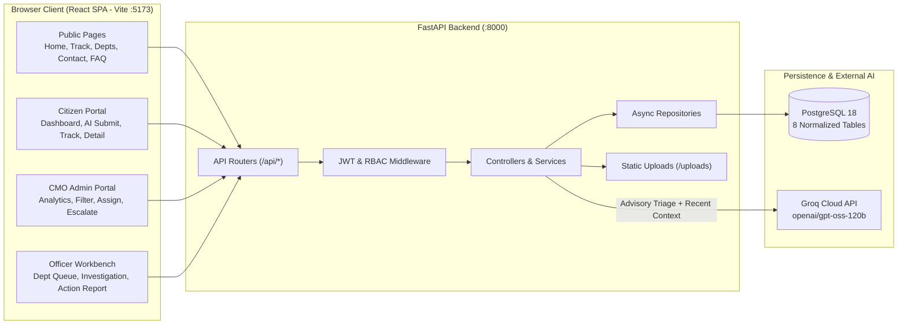
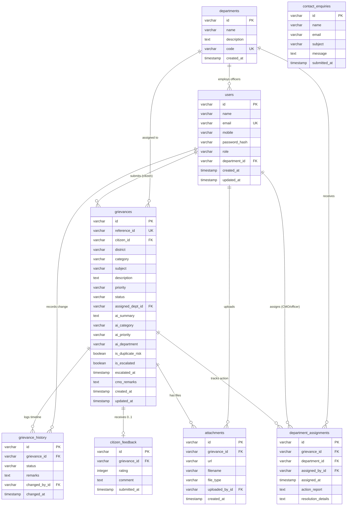

# CM Kerala — Chief Minister's Public Grievance Redressal Portal

> **Recruitment Prototype Disclaimer:** This application is a recruitment assignment prototype built for **WhiteMatrix Software Solutions**. It is **not** affiliated with, endorsed by, or officially operated by the Government of Kerala or the Office of the Chief Minister of Kerala. All sample statistics, support contact information, departments, and demo records are fictional/demonstration data.

---

## Technology Stack

| Layer | Technologies |
| :--- | :--- |
| **Frontend** | React (Vite + TypeScript), React Router, Tailwind CSS, TanStack React Query, React Hook Form, Recharts, Axios, Lucide React, React Hot Toast |
| **Backend** | Python (FastAPI), Uvicorn (ASGI), SQLAlchemy 2.x (Async), Alembic, Pydantic v2, `python-jose` (JWT), `bcrypt` |
| **Database** | PostgreSQL 18 (`asyncpg` driver) |
| **AI Integration** | Groq API (`openai/gpt-oss-120b` via OpenAI-compatible Async SDK) with local keyword duplicate matching & labelled fallback classifier |

[](./frontend)
[](./backend)
[](./DOCUMENTATION/03_Database_Design.md)
[](./DOCUMENTATION/05_AI_Integration.md)

---

## Architecture Overview



---

## Database ER Diagram



---

## Quick Start Guide

### Prerequisites
- **Python:** 3.11+ or 3.12
- **Node.js:** v20+ (tested on v24.16.0 with npm 11.13.0)
- **PostgreSQL:** 18.x running locally (port `5432`)
- **Groq API Key:** Optional for live LLM triage (the portal gracefully falls back to a labelled fallback classifier when unavailable)

### 1. Database Setup (PostgreSQL 18)
Create a PostgreSQL database (for example, `cm_kerala`):
```sql
CREATE DATABASE cm_kerala;
```

### 2. Backend Setup (`backend/`)
```powershell
cd backend

# Create and activate virtual environment (Windows PowerShell)
python -m venv venv
.\venv\Scripts\Activate.ps1

# Install Python dependencies
pip install -r requirements.txt

# Configure environment variables
Copy-Item .env.example .env
# Edit backend/.env with your PostgreSQL credentials, SECRET_KEY, and GROQ_API_KEY

# Run Alembic schema migrations
alembic upgrade head

# Seed 10 Kerala departments, 4 demo users, and 15 sample grievances
python seed.py

# Start the FastAPI server (http://localhost:8000)
python run.py
```
Interactive API documentation is available at `http://localhost:8000/docs` (Swagger UI) once the server is running.

### 3. Frontend Setup (`frontend/`)
```powershell
cd frontend

# Install Node dependencies
npm install

# Configure frontend environment (VITE_API_URL=http://localhost:8000)
# Edit or create frontend/.env if needed

# Start Vite development server (http://localhost:5173)
npm run dev
```

---

## Demo Credentials

The idempotent seed script (`backend/seed.py`) provisions four demonstration accounts across all three RBAC roles. All demo accounts use the password **`Demo@1234`**.

| Role | Name | Email | Password | Department | Portal Landing Route |
| :--- | :--- | :--- | :--- | :--- | :--- |
| `CITIZEN` | Rahul Nair | `citizen@demo.com` | `Demo@1234` | — | `/citizen/dashboard` |
| `CMO_ADMIN` | CMO Administrator | `cmo@demo.com` | `Demo@1234` | — | `/cmo/dashboard` |
| `OFFICER` | Suresh Kumar | `officer@demo.com` | `Demo@1234` | Public Works Department (`PWD`) | `/officer/dashboard` |
| `OFFICER` | Dr. Meera Menon | `health.officer@demo.com` | `Demo@1234` | Health Services (`HLTH`) | `/officer/dashboard` |

> **Tip:** The Login page (`/login`) also provides one-click auto-fill buttons for Citizen, CMO Admin, and Officer (PWD) demo accounts.

---

## Features Checklist

- [x] **Public Portal:** Landing page with Kerala district coverage visual, live public statistics (`/api/stats/public`), About, How It Works, searchable Departments directory (10 seeded departments), FAQ accordion, Contact Enquiry form, and unauthenticated public Reference ID tracking (`/track`).
- [x] **Authentication & RBAC:** Citizen self-registration, JWT (`HS256`, 7-day expiry) login, bcrypt password hashing, and strict role-based route & endpoint guards (`CITIZEN`, `CMO_ADMIN`, `OFFICER`).
- [x] **AI-Assisted Grievance Triage (Human-in-the-Loop):** Live analysis via Groq `openai/gpt-oss-120b` suggesting department, category, priority (`LOW` / `MEDIUM` / `HIGH`), and 100-character CMO summary—plus hybrid duplicate risk detection against the 25 most recent grievances in PostgreSQL and a clearly labelled fallback classifier.
- [x] **Citizen Grievance Lifecycle:** Submit grievances across all 14 Kerala districts, receive auto-generated unique Reference IDs (`GRV-YYYYMMDD-XXXXX`), upload supporting attachments (up to 5 MB), inspect chronological audit timelines, submit 1–5 star ratings & comments on resolved grievances, and reopen resolved grievances with a mandatory reason.
- [x] **CMO Administrative Command Center:** Live KPI cards (Total, Pending, Resolved, Overdue `>7 days`, Escalated), Recharts visualizations (Status Pie, Top Districts Bar, Assigned Departments Bar), multi-facet filtering and sorting, department assignment, official CMO remarks, status overrides, and one-click delay escalation to `HIGH` priority.
- [x] **Department Officer Workbench:** Department-scoped queue with status filter tabs, inspection of citizen complaints, attachments, and CMO remarks, structured Action Taken Reports, Resolution Details, status transitions, and officer evidence uploads.

---

## Documentation Index

Comprehensive technical and user documentation is maintained in [`DOCUMENTATION/`](./DOCUMENTATION):

| # | Document | Description |
| :--- | :--- | :--- |
| 01 | [01_Project_Overview.md](./DOCUMENTATION/01_Project_Overview.md) | Problem statement, objectives, scope, key stakeholders, and complete feature breakdown |
| 02 | [02_System_Architecture.md](./DOCUMENTATION/02_System_Architecture.md) | Layered system design, frontend/backend/database/AI/security architecture & Mermaid diagrams |
| 03 | [03_Database_Design.md](./DOCUMENTATION/03_Database_Design.md) | Schema specification for all 8 PostgreSQL tables, relationships, constraints, indexes, and ER diagram |
| 04 | [04_API_Documentation.md](./DOCUMENTATION/04_API_Documentation.md) | Full REST API reference across all 25 endpoints with headers, parameters, and sample JSON |
| 05 | [05_AI_Integration.md](./DOCUMENTATION/05_AI_Integration.md) | Groq `openai/gpt-oss-120b` integration, prompts, duplicate detection, HITL safeguards, and fallback logic |
| 06 | [06_Setup_and_Testing.md](./DOCUMENTATION/06_Setup_and_Testing.md) | Local installation guide, environment variables, Alembic migrations, seeding, and manual/automated tests |
| 07 | [07_User_Guide.md](./DOCUMENTATION/07_User_Guide.md) | Role-based walkthrough for Public Visitors, Citizens, CMO Administrators, and Department Officers |
